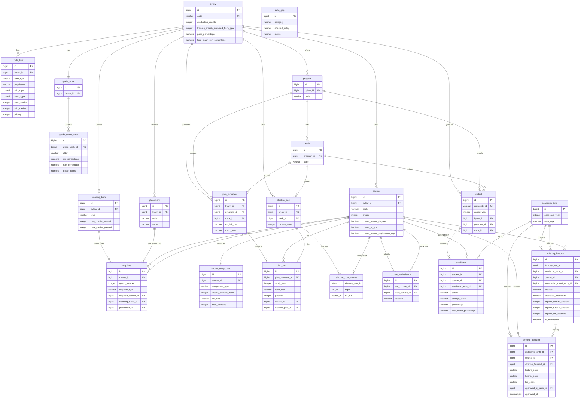
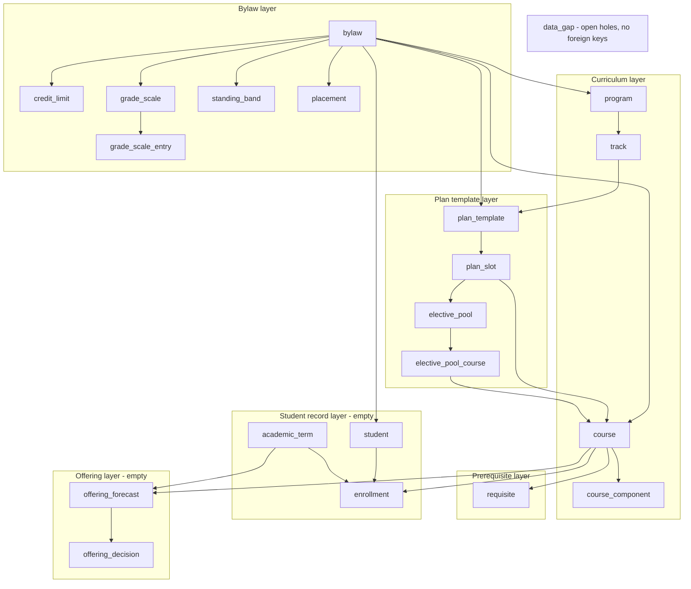
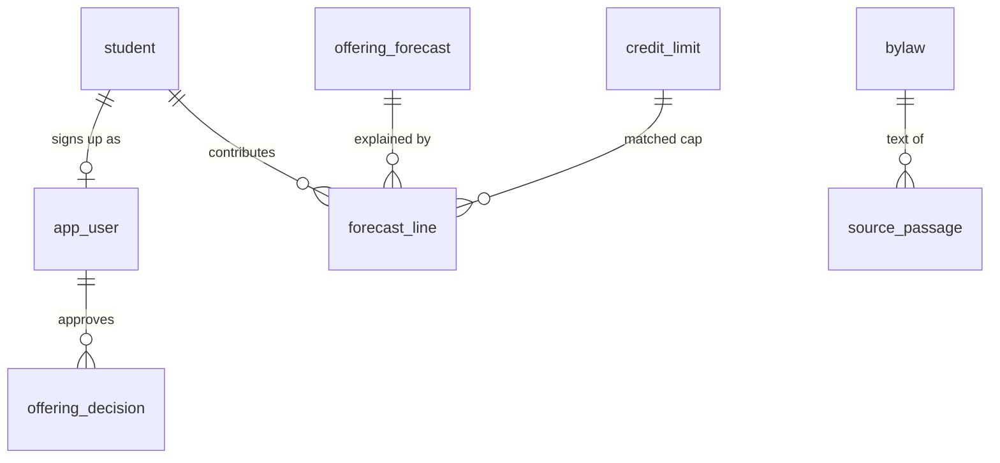

# Academic rules database — design document

This document is the relational design for the graduation project. It is the design agreed for Nile University, School of Information Technology and Computer Science.

It is not a dump of a live PostgreSQL database. No migrations were applied, and the git repository was left empty on purpose. Nothing below was counted from a running server. “Seeded” means the design says those rows are reference data. “Empty” means the design forbids rows until a later file arrives.

There are **22 core tables in Phase 1** (Senior Project I), plus three Phase 1 extension tables that sit outside the core (§19). Six core tables stay empty even after the reference data is typed in. The twenty-second core table is `placement`, a controlled lookup for placement-type requisites (§3). Twelve data gaps stay open. No official class size, no old/new course pair, and no student row is invented.

**Option C scope (aligned with the Senior Project I report):**

| Layer | Status |
|---|---|
| **Phase 1 core** | These 22 tables are the **designed** core for the deterministic offering forecast: baseline demand from official `plan_template` / `plan_slot` rows (not dynamic blocks), implied section counts on `offering_forecast`, and coordinator **opening** flags on `offering_decision`. **Not created in PostgreSQL yet.** |
| **Phase 1 extensions** | `app_user` (student signup and staff roles), `forecast_line` (the rule that set each student's p), and `source_passage` (bylaw text for the read-only retrieval explanation). Outside the 22-table core count; `app_user` is added first when implementation starts. See §19. **Not created.** |
| **Phase 2** | The advising module, which starts after the offering module is finished: `student_plan`, `offering_block`, `block_membership`, `block_forecast_link`, `advising_case`, `advising_message`. **Designed continuation only** — see §20. Not part of the 22-table core count and not implemented. |

---

## 1. Database overview

The database holds two academic rule sets at the same time and does not mix them.

- The old Computer Science bylaw: 135 credits, pass at 50 percent, course codes such as `CSCI 207`.
- The 2025 school bylaw: 138 credits, 6 training credits outside the GPA, pass at 60 percent, course codes such as `CSC 101`.

A course belongs to one bylaw. `CSCI 305` and `CSC 221` are different rows. A plan template is an official path (track, English placement, math placement). It is not a student. A requisite is a course, a `standing_band` row, or a `placement` row. Same group number means AND. A different group number means OR.

Students, enrollments, forecasts, offering decisions, and course equivalences are tables with no rows. The registration file can be loaded later into `student` and `enrollment` without a new schema.

Passing is `percentage >= bylaw.pass_percentage` for that student’s bylaw, and, when the bylaw sets `final_exam_min_percentage`, also `final_exam_percentage >= final_exam_min_percentage`. It is not a global flag. Fifty-five percent passes the old bylaw and fails the 2025 bylaw. Under the 2025 bylaw, 70 percent overall with 25 percent of the final examination also fails.

---

## 2. Complete table catalog

### A. Bylaw / rule tables

**`bylaw`**
One official rule set. A student, a course, and a plan template each point at exactly one bylaw.

**`credit_limit`**
One registration cap or floor: term type, who it applies to, CGPA bounds, and the credit number. Several rows belong to one bylaw. The lowest matching priority wins. A null max means the article never stated the number.

**`grade_scale`**
The grade scale header for one bylaw. One bylaw has one scale.

**`grade_scale_entry`**
One letter on that scale: percentage bounds and grade points. Letters are not shared across bylaws.

**`standing_band`**
One academic level for one bylaw, defined by credits already passed. The 2025 bands have numbers. The old senior band does not.

**`placement`**
One named placement or certificate prerequisite for one bylaw (for example high-school mathematics). Requisite rows of type `placement` point here instead of storing a free-text code.

### B. Course / curriculum tables

**`program`**
A degree program inside one bylaw. The old bylaw has Computer Science. The 2025 bylaw names four programs. Only Computer Science gets courses in the first seed.

**`track`**
A concentration inside a program. Old sheets cover Media and Big Data. The 2025 Computer Science bylaw names four tracks. A track may exist before any plan template does.

**`course`**
A course offering code inside one bylaw: title, credits, and three separate flags — whether the credits count toward the degree, toward the GPA, and toward the registration cap. Remedial and training courses are rows here. They are not a separate system.

**`course_component`**
Weekly lecture, tutorial, or lab hours for one course, and for a lab, which kind of lab it is. A component with zero hours is not stored. `max_students` exists and stays null.

**`course_equivalence`**
A claimed pair between an old-bylaw course and a 2025 course. The table exists so a confirmed pair has a place. It has no rows. Matching titles are not equivalences.

### C. Prerequisite tables

**`requisite`**
One requirement of one target course. The requirement is another course, a standing band, or a placement lookup row. Group number encodes AND and OR.

### D. Study plan template tables

**`plan_template`**
One official path: bylaw, program, track, English path, and math path. The eight spreadsheet sheets are eight **baseline plan templates** for Phase 1 planned demand. They are not Phase 2 **dynamic offering blocks**. These columns do not live on the student ID.

**`plan_slot`**
One position in a template: year, fall or spring, and either one course or one elective pool.

**`elective_pool`**
A set of courses from which a slot chooses a fixed count. “Choose one 3-credit elective” is a pool, not eight copied courses.

**`elective_pool_course`**
The junction between a pool and a course. This is the only pure many-to-many in the schema.

### E. Student / academic record tables

**`student`**
The person, once the registration file exists. Cohort year is stored. Bylaw is stored as a foreign key, chosen from that year when the file is loaded. Track and placement are optional. They are not decoded from the ID.

**`academic_term`**
A real fall, spring, or summer in a given year. No historical years are invented in advance.

**`enrollment`**
One attempt of one student in one course in one term, with the course percentage and, for 2025 rows, the final-exam percentage. A repeat is a new row in a later term. The old attempt stays.

### F. Course offering tables

**`offering_forecast`**
A predicted headcount for one course in one target term from one forecast run, plus **implied** lecture, tutorial, and lab section counts calculated from team-stated class sizes (lecture 60, tutorial 30, physics or circuits lab 15, other Computer Science lab 30). The class sizes used are stored on the row. The row also records the method, the information cutoff, and why the headcount is incomplete, if it is. The formula does not read `course_component.max_students`.

**`offering_decision`**
The coordinator’s **opening decision** per component (lecture, tutorial, lab): a yes/no flag for whether to open that component for the term. It may differ from the implied counts on the linked forecast. Approval is a signed-in coordinator and a time. The coordinator does not type a section count in place of the formula.

### G. Data quality tables

**`data_gap`**
An open or resolved hole: missing number, conflicting sheet, or a table that is empty because nobody has confirmed the fact. It has no foreign keys, because the missing thing may not have a row to point at.

---

## 3. Complete column definitions

Conventions for every table:

- `id` is `bigint`, generated identity, primary key.
- `created_at` and `updated_at` are `timestamptz`, not null, default `now()`.
- Enum-like values are `varchar` plus a `CHECK`, not a PostgreSQL enum.
- `source_reference` is `text` on **reference and catalog tables** (bylaw, limits, courses, requisites, plan rows, and similar). It names the article or sheet cell the row was taken from. It is not on `student`, `enrollment`, or `offering_decision`. On `offering_forecast` it records the forecast method label (for example baseline Phase 1 rules and hidden-semester cutoff), not a bylaw article.

### `bylaw`

| Column | Type | Nullable | PK | FK | Unique | Default | Description |
|---|---|---|---|---|---|---|---|
| id | bigint | NO | YES | — | YES | identity | Internal identifier |
| code | varchar(32) | NO | NO | — | YES | — | `old_cs` or `bylaw_2025` |
| name | varchar(200) | NO | NO | — | NO | — | Display name |
| description | text | YES | NO | — | NO | — | Short scope note |
| graduation_credits | integer | NO | NO | — | NO | — | Credits required to graduate. Check `> 0` |
| training_credits_excluded_from_gpa | integer | YES | NO | — | NO | — | Credits that do not enter the GPA. Check `>= 0` when set |
| pass_percentage | numeric(5,2) | NO | NO | — | NO | — | Minimum percentage to pass. Check `between 0 and 100` |
| final_exam_min_percentage | numeric(5,2) | YES | NO | — | NO | — | Minimum share of the final exam. Null when the bylaw does not state one. When set, check `between 0 and 100` |
| source_reference | text | NO | NO | — | NO | — | Where the numbers were read |
| created_at | timestamptz | NO | NO | — | NO | now() | Row creation |
| updated_at | timestamptz | NO | NO | — | NO | now() | Last change |

Designed seed:

| code | graduation_credits | training excluded from GPA | pass % | final exam min |
|---|---|---|---|---|
| old_cs | 135 | null | 50.00 | null |
| bylaw_2025 | 138 | 6 | 60.00 | 30.00 |

The old bylaw does not say that training is outside the GPA, and it does not state a final-exam floor. Those cells stay null.

### `credit_limit`

| Column | Type | Nullable | PK | FK | Unique | Default | Description |
|---|---|---|---|---|---|---|---|
| id | bigint | NO | YES | — | YES | identity | Internal identifier |
| bylaw_id | bigint | NO | NO | bylaw.id | NO | — | Which rule set |
| term_type | varchar(16) | NO | NO | — | NO | — | `fall_spring` or `summer` |
| population | varchar(40) | NO | NO | — | NO | — | Who the row applies to. See check below |
| min_cgpa | numeric(4,2) | YES | NO | — | NO | — | Lower CGPA bound. Null means no lower bound |
| max_cgpa | numeric(4,2) | YES | NO | — | NO | — | Upper CGPA bound. Null means no upper bound |
| min_cgpa_inclusive | boolean | NO | NO | — | NO | false | Whether `min_cgpa` includes equality |
| max_cgpa_inclusive | boolean | NO | NO | — | NO | false | Whether `max_cgpa` includes equality |
| max_credits | integer | YES | NO | — | NO | — | Maximum credits. Null means the source never stated it |
| min_credits | integer | YES | NO | — | NO | — | Minimum credits. Null means this row sets no floor |
| priority | integer | NO | NO | — | with bylaw_id | — | Lowest number wins among matching rows. Unique `(bylaw_id, priority)` |
| source_reference | text | NO | NO | — | NO | — | Article the row was taken from |
| created_at | timestamptz | NO | NO | — | NO | now() | |
| updated_at | timestamptz | NO | NO | — | NO | now() | |

Checks:

- `term_type in ('fall_spring', 'summer')`
- `population in ('default', 'past_first_year', 'first_semester', 'graduating', 'credits_remaining_below_minimum')`
- if both CGPA bounds are set, `min_cgpa < max_cgpa`
- `max_credits` is null or `>= 0`
- `min_credits` is null or `>= 0`

How a row matches a student for a **maximum**:

1. Term type matches.
2. If the row has CGPA bounds, the student’s CGPA falls inside them. A null student CGPA does not match a bounded row.
3. `population = 'default'`, or `population` equals the student’s situation.
4. `max_credits` is the value being sought (ignore rows that only set a minimum).
5. The matching row with the lowest `priority` wins.

The same steps apply to a **minimum**, using rows whose `min_credits` is not null.

A row with `population = 'credits_remaining_below_minimum'` and `min_credits` null means the fixed floor of 9 is waived. The number of credits left is a fact about that student, not a second constant.

#### Old bylaw rows

| priority | term | population | CGPA | max | min |
|---|---|---|---|---|---|
| 1 | fall_spring | default | below 2.0 (max 2.0, not inclusive) | 13 | — |
| 2 | fall_spring | past_first_year | above 3.0 (min 3.0, not inclusive) | 21 | — |
| 3 | fall_spring | default | any CGPA not caught above | 19 | — |
| 4 | summer | default | any | 7 | — |

Exactly 3.0 does **not** get 21. The article says above 3.0. A first-year student does **not** get 21, because that row also requires `past_first_year`.

The old bylaw does not define “first year”. It is not “under 27 credits” and not “the first two semesters”; those thresholds belong to the 2025 bylaw. Until an old-bylaw article defines it, no student is classified as `past_first_year`, so priority 2 never matches. An old-bylaw student above 3.0 falls to priority 3 (19), and the forecast counts that student in `offering_forecast.first_year_undefined_student_count`, so the headcount is marked incomplete. Old Article 16 also requires the advisor’s approval for the 21-credit load. That approval belongs to the Phase 2 advising workflow and is not a column here.

#### 2025 bylaw rows

| priority | term | population | CGPA | max | min |
|---|---|---|---|---|---|
| 1 | fall_spring | first_semester | any, including unknown | 18 | — |
| 2 | fall_spring | default | below 2.0 | 12 | — |
| 3 | fall_spring | default | at least 3.3 (min 3.3, inclusive) | 21 | — |
| 4 | fall_spring | graduating | any | 21 | — |
| 5 | fall_spring | default | at least 2.0 and below 3.0 | 18 | — |
| 6 | fall_spring | default | at least 3.0 and below 3.3 | **null** | — |
| 7 | fall_spring | default | any not caught above | — | 9 |
| 8 | fall_spring | credits_remaining_below_minimum | any | — | null (floor waived) |
| 9 | summer | graduating | any | 9 | — |
| 10 | summer | default | any | 6 | — |

Priority 6 is the open gap. It must be inserted. Its maximum must stay null. A graduating student inside that band matches priority 4 first and receives 21.

The order also means a graduating student below 2.0 matches priority 2 (12) before priority 4 (21). Article 10 has to be re-read to confirm that the low-GPA cap outranks the graduating allowance. If it does not, only the two priorities swap; no row changes.

### `grade_scale`

| Column | Type | Nullable | PK | FK | Unique | Default | Description |
|---|---|---|---|---|---|---|---|
| id | bigint | NO | YES | — | YES | identity | |
| bylaw_id | bigint | NO | NO | bylaw.id | YES | — | One scale per bylaw |
| source_reference | text | NO | NO | — | NO | — | Grade article, not the transfer-conversion article |
| created_at | timestamptz | NO | NO | — | NO | now() | |
| updated_at | timestamptz | NO | NO | — | NO | now() | |

### `grade_scale_entry`

| Column | Type | Nullable | PK | FK | Unique | Default | Description |
|---|---|---|---|---|---|---|---|
| id | bigint | NO | YES | — | YES | identity | |
| grade_scale_id | bigint | NO | NO | grade_scale.id | NO | — | |
| letter | varchar(4) | NO | NO | — | with scale | — | `A+`, `A`, `F`, and the rest. Unique `(grade_scale_id, letter)` |
| min_percentage | numeric(5,2) | YES | NO | — | NO | — | Lower bound. Null only if the article has no lower bound. When set, check `between 0 and 100` |
| max_percentage | numeric(5,2) | YES | NO | — | NO | — | Upper bound. When set, check `between 0 and 100` |
| min_inclusive | boolean | NO | NO | — | NO | true | |
| max_inclusive | boolean | NO | NO | — | NO | false | The top band of the scale is the inclusive 100 |
| grade_points | numeric(3,2) | NO | NO | — | NO | — | Points per credit hour |
| source_reference | text | NO | NO | — | NO | — | Same grade article as the parent scale |
| created_at | timestamptz | NO | NO | — | NO | now() | |
| updated_at | timestamptz | NO | NO | — | NO | now() | |

Pass or fail does **not** live on this row. See section 7.

The 2025 transfer table (the article that converts grades from other universities) is not this table.

Designed seed, transcribed from old Article 21 and 2025 Article 17 (the same values as Appendix E of the report). Each band includes its lower bound and excludes its upper bound, except the top band, which includes 100. The F band has no lower bound in either article, so `min_percentage` is null.

| letter | grade_points | old bylaw (Art. 21) | 2025 bylaw (Art. 17) |
|---|---|---|---|
| A+ | 4.00 | 97–100 | 97–100 |
| A | 4.00 | 90 to below 97 | 93 to below 97 |
| A− | 3.70 | 85 to below 90 | 89 to below 93 |
| B+ | 3.30 | 80 to below 85 | 84 to below 89 |
| B | 3.00 | 75 to below 80 | 80 to below 84 |
| B− | 2.70 | 70 to below 75 | 76 to below 80 |
| C+ | 2.30 | 65 to below 70 | 73 to below 76 |
| C | 2.00 | 62 to below 65 | 70 to below 73 |
| C− | 1.70 | 58 to below 62 | 67 to below 70 |
| D+ | 1.30 | 55 to below 58 | 64 to below 67 |
| D | 1.00 | 50 to below 55 | 60 to below 64 |
| F | 0.00 | below 50 | below 60 |

Several 2025 percentage lines are split across the PDF text, so both scales are re-checked against the original PDFs when the rows are seeded. If the PDF disagrees, the PDF wins. The lowest passing band of each scale (D) starts at that bylaw’s `pass_percentage`, which is a useful seed check.

### `standing_band`

| Column | Type | Nullable | PK | FK | Unique | Default | Description |
|---|---|---|---|---|---|---|---|
| id | bigint | NO | YES | — | YES | identity | |
| bylaw_id | bigint | NO | NO | bylaw.id | NO | — | |
| level | varchar(16) | NO | NO | — | with bylaw | — | `freshman`, `sophomore`, `junior`, `senior`. Unique `(bylaw_id, level)` |
| min_credits_passed | integer | YES | NO | — | NO | — | Inclusive lower bound. Null means the number was not in the source |
| max_credits_passed | integer | YES | NO | — | NO | — | Exclusive upper bound. Null means no upper bound |
| source_reference | text | NO | NO | — | NO | — | |
| created_at | timestamptz | NO | NO | — | NO | now() | |
| updated_at | timestamptz | NO | NO | — | NO | now() | |

2025 seed (2025 bylaw, Article 20):

| level | min (inclusive) | max (exclusive) |
|---|---|---|
| freshman | 0 | 27 |
| sophomore | 27 | 62 |
| junior | 62 | 96 |
| senior | 96 | null |

Old seed:

| level | min | max |
|---|---|---|
| senior | null | null |

That old row is the study-plan phrase “Senior Standing”, which carries no number. Old Article 24 gives an approximate classification in steps of about 20 percent of the degree: freshman 0–35, sophomore 36–70, junior 71–105, senior 106–135 passed credits. Whether that band governs the “Senior Standing” requisite has not been confirmed (Nile ask 4). Until it is, the old senior row keeps a null minimum — **do not seed 106** until Nile confirms — the other three old levels are not inserted, and the Article 24 numbers live only in the `data_gap` note. Confirming them means filling four rows, not changing the schema.

### `placement`

| Column | Type | Nullable | PK | FK | Unique | Default | Description |
|---|---|---|---|---|---|---|---|
| id | bigint | NO | YES | — | YES | identity | |
| bylaw_id | bigint | NO | NO | bylaw.id | NO | — | Same bylaw as the courses that may require this placement |
| code | varchar(64) | NO | NO | — | with bylaw | — | Stable key, for example `high_school_math`. Unique `(bylaw_id, code)` |
| name | varchar(200) | NO | NO | — | NO | — | Display label |
| source_reference | text | NO | NO | — | NO | — | Bylaw table or certificate wording |
| created_at | timestamptz | NO | NO | — | NO | now() | |
| updated_at | timestamptz | NO | NO | — | NO | now() | |

Designed seed (2025 bylaw only, from prerequisite tables that cite the school certificate rather than a catalog course):

| code | name |
|---|---|
| high_school_math | High-school mathematics (certificate prerequisite) |

The old bylaw sheets in hand do not use placement-type requisites; no old `placement` rows are designed yet.

### `program`

| Column | Type | Nullable | PK | FK | Unique | Default | Description |
|---|---|---|---|---|---|---|---|
| id | bigint | NO | YES | — | YES | identity | |
| bylaw_id | bigint | NO | NO | bylaw.id | NO | — | |
| code | varchar(16) | NO | NO | — | with bylaw | — | Unique `(bylaw_id, code)` |
| name | varchar(200) | NO | NO | — | NO | — | |
| source_reference | text | NO | NO | — | NO | — | |
| created_at | timestamptz | NO | NO | — | NO | now() | |
| updated_at | timestamptz | NO | NO | — | NO | now() | |

Designed names: old `CS`. New `CS`, `AI`, `BMD`, `CSEC`. Only old and new Computer Science receive courses.

### `track`

| Column | Type | Nullable | PK | FK | Unique | Default | Description |
|---|---|---|---|---|---|---|---|
| id | bigint | NO | YES | — | YES | identity | |
| program_id | bigint | NO | NO | program.id | NO | — | |
| code | varchar(32) | NO | NO | — | with program | — | Unique `(program_id, code)` |
| name | varchar(200) | NO | NO | — | NO | — | |
| source_reference | text | NO | NO | — | NO | — | |
| created_at | timestamptz | NO | NO | — | NO | now() | |
| updated_at | timestamptz | NO | NO | — | NO | now() | |

Old Computer Science tracks that the sheets actually use: Media, Big Data. The old bylaw also names a general Computer Science path. That name can be a track row. It has no plan template in the spreadsheet, so no slots are invented for it.

2025 Computer Science tracks named in the bylaw, with no spreadsheet templates yet: Data Engineering and Analytics, Media Informatics, Software Engineering, Quantum Computing.

### `course`

| Column | Type | Nullable | PK | FK | Unique | Default | Description |
|---|---|---|---|---|---|---|---|
| id | bigint | NO | YES | — | YES | identity | |
| bylaw_id | bigint | NO | NO | bylaw.id | NO | — | Exactly one bylaw |
| code | varchar(32) | NO | NO | — | with bylaw | — | Unique `(bylaw_id, code)` after trimming. Not unique across bylaws |
| title | varchar(300) | NO | NO | — | NO | — | |
| credits | integer | NO | NO | — | NO | — | Check `>= 0`. Zero is allowed |
| counts_toward_degree | boolean | YES | NO | — | NO | — | Whether the credits count toward the graduation total. Null means the source did not say |
| counts_in_gpa | boolean | YES | NO | — | NO | — | Whether credits enter the GPA. Null means the source did not say |
| counts_toward_registration_cap | boolean | YES | NO | — | NO | — | Whether the course consumes the term registration cap. Null until Nile confirms (training/internship) |
| min_students_to_open | integer | YES | NO | — | NO | null | Minimum headcount to open a section. **Designed null** — no NU policy yet |
| max_attempts | integer | YES | NO | — | NO | null | Maximum attempts. **Designed null** — no bylaw rule stated |
| source_reference | text | NO | NO | — | NO | — | Sheet name or bylaw table |
| created_at | timestamptz | NO | NO | — | NO | now() | |
| updated_at | timestamptz | NO | NO | — | NO | now() | |

The three flags are kept separate because the sources treat them separately. One cannot be inferred from another.

| Course kind | counts_toward_degree | counts_in_gpa | counts_toward_registration_cap |
|---|---|---|---|
| Ordinary course, both bylaws | true | true | true |
| `ENGL 001`, `Math 100` (old, 0 credits) | false | false | true (adds 0 credits) |
| 2025 training courses | true (part of the 138) | false (2025 Art. 36: the 6 training credits stay out of the GPA) | **null** |
| Old internship courses `COMM 401`, `CSCI 490` | true (part of the 135, old Art. 17) | true | **null** |

The old bylaw states no exclusion from the GPA, and its internship and training credits are part of the 135-credit total. The design therefore treats the two old internship courses as counting toward the GPA; this is the reading the report uses. Whether internship and training consume the registration cap is unresolved for both bylaws (Nile ask 6), so that flag is null and is not inferred from the GPA rule. §17a describes how the forecast handles a null cap flag.

### `course_component`

| Column | Type | Nullable | PK | FK | Unique | Default | Description |
|---|---|---|---|---|---|---|---|
| id | bigint | NO | YES | — | YES | identity | |
| course_id | bigint | NO | NO | course.id | NO | — | |
| component_type | varchar(16) | NO | NO | — | with course | — | `lecture`, `tutorial`, or `lab`. Unique `(course_id, component_type)` |
| weekly_contact_hours | integer | NO | NO | — | NO | — | Check `> 0`. Zero hours means no row |
| lab_kind | varchar(24) | YES | NO | — | NO | — | `physics_circuits` or `computing`. Set only when `component_type = 'lab'`. Chooses the team class size (15 or 30) |
| max_students | integer | YES | NO | — | NO | null | Seat capacity. No source states it. Stays null |
| source_reference | text | NO | NO | — | NO | — | 2025 course table |
| created_at | timestamptz | NO | NO | — | NO | now() | |
| updated_at | timestamptz | NO | NO | — | NO | now() | |

Check: `lab_kind` is set exactly when `component_type = 'lab'`. The kind is a team classification: labs of physics and circuits courses (for example `PHYS` and `ECEN` codes) are `physics_circuits`, and every other Computer Science lab is `computing`. It is not bylaw text.

There is no check that forces `max_students` to stay null forever. When the university states a class size, the column can be filled. Until then every row is null, and nothing computes sections from it.

Old courses do not get component rows. The spreadsheet has credits, not weekly hours. As a result, an old-bylaw course gets a headcount but **no implied sections**: its three implied columns on `offering_forecast` stay null until its components are known (data gap “old weekly hours”). The coordinator still records an opening decision for it.

`CSC 101`, from the 2025 table already read: lecture 2, tutorial 2, lab 1. Confirm those three numbers against the PDF again at seed time. If the PDF disagrees, the PDF wins.

### `requisite`

| Column | Type | Nullable | PK | FK | Unique | Default | Description |
|---|---|---|---|---|---|---|---|
| id | bigint | NO | YES | — | YES | identity | |
| course_id | bigint | NO | NO | course.id | NO | — | The course the student wants |
| group_number | integer | NO | NO | — | NO | — | Check `> 0`. Same number = AND. Different numbers = OR |
| requisite_type | varchar(16) | NO | NO | — | NO | — | `course`, `standing`, or `placement` |
| required_course_id | bigint | YES | NO | course.id | NO | — | Set only when type is `course` |
| standing_band_id | bigint | YES | NO | standing_band.id | NO | — | Set only when type is `standing`. Must belong to the **same bylaw** as the target `course_id` (§15) |
| placement_id | bigint | YES | NO | placement.id | NO | — | Set only when type is `placement`. Must belong to the same bylaw as the target course |
| source_reference | text | NO | NO | — | NO | — | Sheet cell or bylaw line, after the cell was split by hand |
| created_at | timestamptz | NO | NO | — | NO | now() | |
| updated_at | timestamptz | NO | NO | — | NO | now() | |

Checks (see §15 for SQL):

- `requisite_type in ('course', 'standing', 'placement')`
- Exactly one of `required_course_id`, `standing_band_id`, and `placement_id` is non-null, and it matches `requisite_type` (course / standing / placement respectively). The other two target columns are null.

Foreign keys prove the referenced course, band, or placement row exists. Same-bylaw alignment for courses and bands is enforced at seed review and by cross-bylaw triggers in §15 (Phase 1 migration sketches).

A cell whose only value is `#N/A` produces no row.

### `plan_template`

| Column | Type | Nullable | PK | FK | Unique | Default | Description |
|---|---|---|---|---|---|---|---|
| id | bigint | NO | YES | — | YES | identity | |
| bylaw_id | bigint | NO | NO | bylaw.id | NO | — | The templates in hand are the old bylaw |
| program_id | bigint | NO | NO | program.id | NO | — | Computer Science |
| track_id | bigint | NO | NO | track.id | NO | — | Media or Big Data for the eight sheets |
| english_path | varchar(16) | NO | NO | — | NO | — | `intensive` or `english_1` |
| math_path | varchar(16) | NO | NO | — | NO | — | `precalculus` or `calculus_1` |
| source_sheet | varchar(64) | NO | NO | — | YES | — | Workbook sheet name |
| source_reference | text | NO | NO | — | NO | — | Workbook identity |
| created_at | timestamptz | NO | NO | — | NO | now() | |
| updated_at | timestamptz | NO | NO | — | NO | now() | |

Unique `(bylaw_id, track_id, english_path, math_path)`.

The eight sheet names:

| source_sheet | track | english_path | math_path |
|---|---|---|---|
| Science_Intensive_Media | Media | intensive | precalculus |
| Science_Intensive_bigdata | Big Data | intensive | precalculus |
| Science_ENGL1_Media | Media | english_1 | precalculus |
| Science_ENGL1_Bigdata | Big Data | english_1 | precalculus |
| Math_Intensive_Media | Media | intensive | calculus_1 |
| Math_Intensive_Bigdata | Big Data | intensive | calculus_1 |
| Math_ENGL1_Media | Media | english_1 | calculus_1 |
| Math_ENGL1_Bigdata | Big Data | english_1 | calculus_1 |

`Science_*` sheets start students in pre-calculus (`Math 100`). `Math_*` sheets start them in Calculus I. That naming is the workbook’s, and it is easy to misread. The `math_path` column is the explicit value.

A sheet whose semester grid is too shifted to trust does not get guessed slots. The template row can exist, and the bad region is a data gap.

### `plan_slot`

| Column | Type | Nullable | PK | FK | Unique | Default | Description |
|---|---|---|---|---|---|---|---|
| id | bigint | NO | YES | — | YES | identity | |
| plan_template_id | bigint | NO | NO | plan_template.id | NO | — | |
| study_year | integer | NO | NO | — | NO | — | 1 to 4 on these sheets. Check `between 1 and 6` so a later plan is not blocked |
| term_type | varchar(16) | NO | NO | — | NO | — | `fall` or `spring`. Summer is not a column of these grids |
| position | integer | NO | NO | — | NO | — | Order inside that term. Check `> 0` |
| course_id | bigint | YES | NO | course.id | NO | — | Set when the slot is a specific course |
| elective_pool_id | bigint | YES | NO | elective_pool.id | NO | — | Set when the slot is a choice |
| source_reference | text | NO | NO | — | NO | — | Sheet and cell |
| created_at | timestamptz | NO | NO | — | NO | now() | |
| updated_at | timestamptz | NO | NO | — | NO | now() | |

Checks (see §15 for SQL):

- Unique `(plan_template_id, study_year, term_type, position)`
- Exactly one of `course_id` and `elective_pool_id` is set (XOR: one and only one non-null)

### `elective_pool`

| Column | Type | Nullable | PK | FK | Unique | Default | Description |
|---|---|---|---|---|---|---|---|
| id | bigint | NO | YES | — | YES | identity | |
| bylaw_id | bigint | NO | NO | bylaw.id | NO | — | |
| track_id | bigint | YES | NO | track.id | NO | — | Null when the pool is not track-specific |
| name | varchar(200) | NO | NO | — | NO | — | For example “Big Data technical elective” |
| choose_count | integer | NO | NO | — | NO | — | How many courses the slot takes. Check `> 0` |
| source_reference | text | NO | NO | — | NO | — | Map, sheet, or both |
| created_at | timestamptz | NO | NO | — | NO | now() | |
| updated_at | timestamptz | NO | NO | — | NO | now() | |

Credits live on the course, not as a single pool-wide guess. The map’s “3 credit hours” is checked against each member course.

### `elective_pool_course`

| Column | Type | Nullable | PK | FK | Unique | Default | Description |
|---|---|---|---|---|---|---|---|
| elective_pool_id | bigint | NO | YES | elective_pool.id | NO | — | |
| course_id | bigint | NO | YES | course.id | NO | — | Composite primary key |

No extra payload. If the map names a course the sheet does not, that course is not inserted “to be helpful.” The pool stays short, and `data_gap` records the conflict.

### `course_equivalence`

| Column | Type | Nullable | PK | FK | Unique | Default | Description |
|---|---|---|---|---|---|---|---|
| id | bigint | NO | YES | — | YES | identity | |
| old_course_id | bigint | NO | NO | course.id | NO | — | Must be an old-bylaw course. Enforced at seed review |
| new_course_id | bigint | NO | NO | course.id | NO | — | Must be a 2025 course |
| relation | varchar(32) | NO | NO | — | NO | — | `same_content`, `partial`, `related`. No `unconfirmed` row is inserted in place of a decision |
| source_reference | text | NO | NO | — | NO | — | Who confirmed it, and where |
| created_at | timestamptz | NO | NO | — | NO | now() | |
| updated_at | timestamptz | NO | NO | — | NO | now() | |

Checks: `old_course_id <> new_course_id`. Unique `(old_course_id, new_course_id)`.

Designed row count: **0**.

### `student`

| Column | Type | Nullable | PK | FK | Unique | Default | Description |
|---|---|---|---|---|---|---|---|
| id | bigint | NO | YES | — | YES | identity | |
| university_id | varchar(32) | NO | NO | — | YES | — | The real ID. Not invented |
| cohort_year | integer | NO | NO | — | NO | — | Year taken from that ID. Check `between 1990 and 2100` (sane calendar range; tighten at load if the registrar states a narrower band) |
| bylaw_id | bigint | NO | NO | bylaw.id | NO | — | Set at load from the cohort rule below |
| program_id | bigint | YES | NO | program.id | NO | — | Unknown until the file or a later fact says so |
| track_id | bigint | YES | NO | track.id | NO | — | Not on the ID. Stays null until declared or inferred from a track course |
| english_path | varchar(16) | YES | NO | — | NO | — | Same check as the template. Null until known |
| math_path | varchar(16) | YES | NO | — | NO | — | Same check as the template. Null until known |
| created_at | timestamptz | NO | NO | — | NO | now() | |
| updated_at | timestamptz | NO | NO | — | NO | now() | |

Cohort rule, applied when the file is loaded, not as a hard-coded check that embeds bylaw ids:

- cohort year 2024 or earlier, including before 2020 → old bylaw
- cohort year 2025 or later → 2025 bylaw

The student’s baseline template is not stored as a column. Once `track_id`, `english_path`, and `math_path` are known, it is the single `plan_template` matching `(bylaw_id, track_id, english_path, math_path)`, which that table’s unique constraint guarantees. While any of the three is null, the plan is unknown, and the rule engine does not guess one (Nile ask 2).

Name, birthdate, and sign-in details from onboarding are not on this table. They are on `app_user` (§19), so the registration record stays exactly what the university file provides.

Designed row count: **0**.

### `academic_term`

| Column | Type | Nullable | PK | FK | Unique | Default | Description |
|---|---|---|---|---|---|---|---|
| id | bigint | NO | YES | — | YES | identity | |
| academic_year | integer | NO | NO | — | with term | — | The calendar year of that term. Check `between 1990 and 2100` |
| term_type | varchar(16) | NO | NO | — | with year | — | `fall`, `spring`, or `summer`. Unique `(academic_year, term_type)` |
| created_at | timestamptz | NO | NO | — | NO | now() | |
| updated_at | timestamptz | NO | NO | — | NO | now() | |

Designed row count: **0**. Terms are created when a registration row needs them.

### `enrollment`

| Column | Type | Nullable | PK | FK | Unique | Default | Description |
|---|---|---|---|---|---|---|---|
| id | bigint | NO | YES | — | YES | identity | |
| student_id | bigint | NO | NO | student.id | NO | — | |
| course_id | bigint | NO | NO | course.id | NO | — | |
| academic_term_id | bigint | NO | NO | academic_term.id | NO | — | |
| status | varchar(16) | NO | NO | — | NO | — | **File label only** — raw status from the registration export: `registered`, `passed`, `failed`, `withdrawn`, `incomplete`. Never used alone as the pass/fail rule |
| attempt_state | varchar(16) | NO | NO | — | NO | — | **Rule-engine input** for the forecast: `passed`, `failed`, `active`, `withdrawn`, `unresolved`, `not_started`. Derived at import from `status`, term context, and the pass test of §7 |
| percentage | numeric(5,2) | YES | NO | — | NO | — | Numeric course result. Null when the file has no mark. Check `between 0 and 100`. Feeds the pass test; it is not a substitute for `status` |
| final_exam_percentage | numeric(5,2) | YES | NO | — | NO | — | Share of the final examination earned. Needed for the 2025 pass rule. Null when the file does not carry it. Check `between 0 and 100` |
| letter | varchar(4) | YES | NO | — | NO | — | Null when the file has no letter. Display only, never the pass test |
| created_at | timestamptz | NO | NO | — | NO | now() | |
| updated_at | timestamptz | NO | NO | — | NO | now() | |

Unique `(student_id, course_id, academic_term_id)`.

How `attempt_state` is derived at load, relative to the forecast’s information cutoff:

| File status | attempt_state | Note |
|---|---|---|
| `passed`, `failed` with values the pass test needs | `passed` or `failed` from the pass test of §7 | `status` stays the file label; `attempt_state` follows §7, not the label |
| `passed`, `failed` without the values the test needs | the file’s label | Counted in the load report. For 2025 rows this happens when `final_exam_percentage` is missing (Nile ask 1) |
| `registered`, term not finished at the cutoff | `active` | “In the course now” for rule 4 |
| `registered`, term already finished, no result | `unresolved` | Not a failure |
| `withdrawn` | `withdrawn` | Not a failure. Counts as an attempt in historical rates |
| `incomplete` | `unresolved` | Not a failure. 2025 Art. 13 suggests it turns into W if the final is not taken; not encoded until confirmed (Nile ask 7) |

`not_started` is never produced from the file. It is the rule engine’s value for a sheet course that has no enrollment row.

**Import-time validation (Senior Project I):** when `status` is `passed` or `failed` and the row has the percentages the pass test needs, the loader compares the file label to the §7 outcome. A mismatch is **flagged in the load report** (and optionally stored in a load-quality table later); it does not block insert. There is **no** database trigger that rewrites `attempt_state` on every update — derivation runs in the import service. Heavy enforcement stays out of Phase 1 migrations.

There is **no** unique constraint on `(student_id, course_id)`. A later term is a new attempt. The earlier row is not updated into the new grade.

Designed row count: **0**.

### `offering_forecast`

| Column | Type | Nullable | PK | FK | Unique | Default | Description |
|---|---|---|---|---|---|---|---|
| id | bigint | NO | YES | — | YES | identity | |
| forecast_run_id | uuid | NO | NO | — | with course | — | Shared by every row written in one run. Unique `(forecast_run_id, course_id)` |
| academic_term_id | bigint | NO | NO | academic_term.id | NO | — | The term being planned |
| course_id | bigint | NO | NO | course.id | NO | — | |
| information_cutoff_term_id | bigint | NO | NO | academic_term.id | NO | — | Last term whose grades the run may read. For a spring forecast this is the term before that fall |
| is_evaluation_replay | boolean | NO | NO | — | NO | false | True when the run replays a hidden past semester (UC4) |
| method | varchar(16) | NO | NO | — | NO | — | `rates` (old bylaw, at least 30 prior attempts) or `simple_count` (thin history, or any 2025 course) |
| predicted_headcount | numeric(10,2) | NO | NO | — | NO | — | Check `>= 0`. Sum of the remaining p values, not rounded. Unresolved pairs are not in it |
| lecture_class_size | integer | YES | NO | — | NO | — | Team class size used: 60. Null when the course has no lecture row |
| tutorial_class_size | integer | YES | NO | — | NO | — | Team class size used: 30. Null when the course has no tutorial row |
| lab_class_size | integer | YES | NO | — | NO | — | Team class size used: 15 for `physics_circuits`, 30 for `computing`. Null when the course has no lab row |
| implied_lecture_sections | integer | YES | NO | — | NO | — | `ceil(predicted_headcount ÷ lecture_class_size)`. Null when the class size is null |
| implied_tutorial_sections | integer | YES | NO | — | NO | — | `ceil(predicted_headcount ÷ tutorial_class_size)` |
| implied_lab_sections | integer | YES | NO | — | NO | — | `ceil(predicted_headcount ÷ lab_class_size)` |
| unresolved_pair_count | integer | NO | NO | — | NO | 0 | Students whose p for this course is unresolved (unknown repeat intention, unscored standing) |
| null_cap_student_count | integer | NO | NO | — | NO | 0 | Students on this course whose matched maximum is null (2025, CGPA 3.0 to below 3.3, not graduating) |
| first_year_undefined_student_count | integer | NO | NO | — | NO | 0 | Old-bylaw students above 3.0 held at 19 because “first year” is undefined |
| cap_flag_unknown_student_count | integer | NO | NO | — | NO | 0 | Students whose cap trim met a course with a null `counts_toward_registration_cap` |
| is_incomplete | boolean | NO | NO | — | NO | generated | Generated, stored: true when any of the four counts above is greater than 0 |
| source_reference | text | NO | NO | — | NO | — | Method label and rule version, for example `phase1-baseline v1`. Not a bylaw article |
| created_at | timestamptz | NO | NO | — | NO | now() | Also the time of the run |
| updated_at | timestamptz | NO | NO | — | NO | now() | |

Checks: all counts `>= 0`; every class size is null or `> 0`; `information_cutoff_term_id` precedes `academic_term_id` (checked by the forecast service, because term order lives in two columns).

Not unique on term plus course. A later run is a new row with a new `forecast_run_id`, and earlier runs stay for comparison.

The class sizes are a team statement of normal class practice, not bylaw text. They are configuration of the forecast service, and every row stores the values it used, so a later change of practice cannot silently rewrite an old result. Which class sizes are filled follows the course’s `course_component` rows: a course with no component rows, which is every old-bylaw course today, gets a headcount and three null implied counts.

The per-student evidence behind a headcount — the rule that set each p and whether the cap trim dropped it — is kept in `forecast_line` (§19).

Designed row count: **0**.

### `offering_decision`

| Column | Type | Nullable | PK | FK | Unique | Default | Description |
|---|---|---|---|---|---|---|---|
| id | bigint | NO | YES | — | YES | identity | |
| academic_term_id | bigint | NO | NO | academic_term.id | NO | — | |
| course_id | bigint | NO | NO | course.id | NO | — | |
| offering_forecast_id | bigint | YES | NO | offering_forecast.id | NO | — | The forecast the coordinator looked at, if any |
| lecture_open | boolean | YES | NO | — | NO | — | Null until decided. True = open lecture section(s) for this term |
| tutorial_open | boolean | YES | NO | — | NO | — | Same for tutorial |
| lab_open | boolean | YES | NO | — | NO | — | Same for lab |
| decision_notes | text | YES | NO | — | NO | — | Optional reason when opening differs from implied counts |
| approved_by_user_id | bigint | YES | NO | app_user.id | NO | — | The signed-in coordinator who decided. Not a model |
| approved_by_name | varchar(200) | YES | NO | — | NO | — | The coordinator’s name at the time of the decision, kept even if the account changes later |
| approved_at | timestamptz | YES | NO | — | NO | — | |
| created_at | timestamptz | NO | NO | — | NO | now() | |
| updated_at | timestamptz | NO | NO | — | NO | now() | |

Checks:

- If any of `lecture_open`, `tutorial_open`, `lab_open` is not null, then `approved_by_user_id`, `approved_by_name`, and `approved_at` are all set.
- The account named in `approved_by_user_id` has the `coordinator` role. A check constraint cannot read another table, so the workflow service enforces this on every write, and the server never trusts a user id sent by the browser.
- A flag stays null for a component the course does not have. For courses with component rows the service enforces this; old-bylaw courses have no component rows yet, so all three flags are available to the coordinator.

Implied counts live on `offering_forecast`. This table stores only the human opening decision: three yes/no flags, not section counts and not a retyped formula.

Designed row count: **0**.

### `data_gap`

| Column | Type | Nullable | PK | FK | Unique | Default | Description |
|---|---|---|---|---|---|---|---|
| id | bigint | NO | YES | — | YES | identity | |
| category | varchar(64) | NO | NO | — | NO | — | Short label, for example `credit_cap` |
| description | text | NO | NO | — | NO | — | What is missing or in conflict |
| affected_entity | varchar(64) | NO | NO | — | NO | — | Table or concept name. Not a foreign key |
| status | varchar(16) | NO | NO | — | NO | `open` | `open` or `resolved` |
| source_reference | text | YES | NO | — | NO | — | Where the hole was noticed |
| notes | text | YES | NO | — | NO | — | What must not be assumed |
| created_at | timestamptz | NO | NO | — | NO | now() | |
| updated_at | timestamptz | NO | NO | — | NO | now() | |

---

## 4. Relationships

Cardinality is listed once per foreign key.

| From | To | Kind | Plain English |
|---|---|---|---|
| credit_limit.bylaw_id | bylaw.id | N:1 | One bylaw has many credit rules. Each rule belongs to one bylaw |
| grade_scale.bylaw_id | bylaw.id | 1:1 | One bylaw has one grade scale. The unique constraint on `bylaw_id` makes it one-to-one |
| grade_scale_entry.grade_scale_id | grade_scale.id | N:1 | One scale has many letters |
| standing_band.bylaw_id | bylaw.id | N:1 | One bylaw has many standing bands |
| placement.bylaw_id | bylaw.id | N:1 | One bylaw has many placement prerequisites |
| program.bylaw_id | bylaw.id | N:1 | One bylaw has many programs |
| track.program_id | program.id | N:1 | One program has many tracks |
| course.bylaw_id | bylaw.id | N:1 | One bylaw has many courses. Each course has one bylaw |
| course_component.course_id | course.id | N:1 | One course has up to three components |
| requisite.course_id | course.id | N:1 | One course has many requirement rows |
| requisite.required_course_id | course.id | N:1, optional | A course-type requirement points at another course. Standing and placement rows leave this null |
| requisite.standing_band_id | standing_band.id | N:1, optional | A standing requirement points at one band row for the target course’s bylaw |
| requisite.placement_id | placement.id | N:1, optional | A placement requirement points at one placement row for the target course’s bylaw |
| plan_template.bylaw_id | bylaw.id | N:1 | Templates are written under one bylaw |
| plan_template.program_id | program.id | N:1 | A template is for one program |
| plan_template.track_id | track.id | N:1 | A template is for one track |
| plan_slot.plan_template_id | plan_template.id | N:1 | One template has many slots |
| plan_slot.course_id | course.id | N:1, optional | A fixed slot points at one course. The same course can appear in many templates |
| plan_slot.elective_pool_id | elective_pool.id | N:1, optional | A choice slot points at one pool |
| elective_pool.bylaw_id | bylaw.id | N:1 | A pool belongs to one bylaw |
| elective_pool.track_id | track.id | N:1, optional | A pool may be tied to a track |
| elective_pool_course | elective_pool and course | N:M | The junction. One pool contains many courses. One course can sit in more than one pool |
| course_equivalence.old_course_id | course.id | N:1 | Each confirmed pair names one old course. No pairs exist yet |
| course_equivalence.new_course_id | course.id | N:1 | Each confirmed pair names one new course |
| student.bylaw_id | bylaw.id | N:1 | Each student is under one bylaw |
| student.program_id | program.id | N:1, optional | Program may be unknown at first load |
| student.track_id | track.id | N:1, optional | Track is not on the ID |
| enrollment.student_id | student.id | N:1 | One student has many attempts |
| enrollment.course_id | course.id | N:1 | One course is attempted by many students |
| enrollment.academic_term_id | academic_term.id | N:1 | One term contains many attempts |
| offering_forecast.academic_term_id | academic_term.id | N:1 | One term has many headcount predictions |
| offering_forecast.course_id | course.id | N:1 | One course can be predicted in many terms and runs |
| offering_forecast.information_cutoff_term_id | academic_term.id | N:1 | Many forecast rows share one cutoff term |
| offering_decision.academic_term_id | academic_term.id | N:1 | One term has many human decisions |
| offering_decision.course_id | course.id | N:1 | One course can be decided per term |
| offering_decision.offering_forecast_id | offering_forecast.id | N:1, optional | A decision may cite the forecast it used |
| offering_decision.approved_by_user_id | app_user.id | N:1, optional | One coordinator makes many decisions. `app_user` is a Phase 1 extension (§19) |

`plan_slot` is an associative entity between template and course, not a pure junction, because year, term, and position are part of the fact.

`enrollment` is an associative entity between student, course, and term.

`data_gap` has no foreign keys.

```
bylaw 1 ────< N credit_limit
bylaw 1 ────1 grade_scale 1 ────< N grade_scale_entry
bylaw 1 ────< N standing_band
bylaw 1 ────< N placement
bylaw 1 ────< N program 1 ────< N track
bylaw 1 ────< N course 1 ────< N course_component
course 1 ───< N requisite >──── course   (required_course_id, optional)
bylaw + program + track ────< plan_template 1 ────< N plan_slot >──── course
plan_slot >──── elective_pool >────< elective_pool_course >────< course
course >──── course_equivalence >──── course     (zero rows)
bylaw 1 ────< N student 1 ────< N enrollment >──── course
enrollment >──── academic_term
academic_term + course ────< offering_forecast >──── academic_term (information cutoff)
academic_term + course ────< offering_decision >──── offering_forecast (optional)
offering_decision >──── app_user (approver, Phase 1 extension)
```

---

## 5. Full Mermaid ERD

Paste this into GitHub, a Markdown preview, or Mermaid Live.

This diagram shows the 22 core tables. `offering_decision.approved_by_user_id` points at `app_user`, which is drawn with the other Phase 1 extensions in §19.



### Simplified conceptual diagram



---

## 6. How the database represents academic rules

Numbers live in rows, not in application constants.

**Old bylaw, on `bylaw`:** 135 graduation credits, pass at 50 percent. Training-excluded and final-exam minimum are null.

**Old bylaw, on `credit_limit`:** fall/spring max 13 when CGPA is below 2.0; max 21 only when CGPA is above 3.0 and the student is past the first year; otherwise max 19. Summer max 7.

**2025 bylaw, on `bylaw`:** 138 graduation credits, 6 training credits excluded from the GPA, pass at 60 percent, final exam at least 30 percent.

**2025 bylaw, on `credit_limit`:** first semester max 18; CGPA below 2.0 max 12; CGPA at least 3.3 max 21; graduating that year max 21; CGPA at least 2.0 and below 3.0 max 18; minimum 9 unless fewer than 9 credits remain; summer max 6, or 9 in order to graduate.

**2025 CGPA at least 3.0 and below 3.3:** the row exists, and `max_credits` is null. The article never gives that cap. Null is a stored fact that the rule is missing. Putting 18 or 21 there would make a later query look authoritative. A coordinator reading null knows the bylaw must be asked. A coordinator reading 18 would trust a number the university did not write.

---

## 7. Grade scale design

`bylaw.pass_percentage` and `bylaw.final_exam_min_percentage` are the pass rule. `grade_scale_entry` is how a percentage becomes a letter and grade points, inside one bylaw only.

The pass test for one enrollment row:

1. `percentage >= bylaw.pass_percentage`, and
2. if `bylaw.final_exam_min_percentage` is not null, `final_exam_percentage >= bylaw.final_exam_min_percentage`.

If a value the test needs is null, the test is not run and the file’s own status is kept (see the `attempt_state` mapping in §3).

There is no global `is_pass` column. Two scales exist so the same percentage can fall in different letters, and the pass test never looks at a letter from the other bylaw.

Example, once a student row exists:

| Student bylaw | percentage | final exam % | Test | Result |
|---|---|---|---|---|
| old_cs | 55.00 | null | 55 >= 50; no final-exam rule | pass |
| bylaw_2025 | 55.00 | 40.00 | 55 >= 60 fails | fail |
| bylaw_2025 | 70.00 | 25.00 | 70 >= 60, but 25 >= 30 fails | fail |
| bylaw_2025 | 70.00 | 45.00 | both hold | pass |

The student’s `bylaw_id` chooses the thresholds. Application code reads those columns. It does not contain `if old then 50`.

Letter rows are a second step: display and GPA points. They are seeded from the grade article of that bylaw only. The 2025 article that converts another university’s grades into Nile points is not the Nile scale.

---

## 8. Standing design

Standing is credits already passed, per bylaw.

2025, all four bands stored with numbers:

| Level | Credits passed |
|---|---|
| Freshman | 0 up to but not including 27 |
| Sophomore | 27 up to but not including 62 |
| Junior | 62 up to but not including 96 |
| Senior | 96 or more |

Old bylaw: one `standing_band` row, level `senior`, `min_credits_passed` null. The study plan says CSCI 495 requires Senior Standing and does not give a credit count. A requisite of type `standing` points at that row through `standing_band_id` (not a free-text level). The numeric test cannot be evaluated until the gap is closed, so the student–course pair is unresolved: it is kept out of the headcount and counted in `offering_forecast.unresolved_pair_count`. That is intentional.

Old Article 24 gives approximate bands (freshman 0–35, sophomore 36–70, junior 71–105, senior 106–135 passed credits). They are the candidate answer, recorded in the gap note. They become rows only after the faculty confirms that the Article 24 band governs the requisite.

---

## 9. Course design

`course` is the catalog line: code, title, credits, bylaw, and the three flags for degree credits, GPA, and registration cap. Separation by `bylaw_id` is what keeps old `CSCI` codes from colliding with 2025 `CSC` codes. Uniqueness is `(bylaw_id, code)`, not `code` alone.

`ENGL 001` and `Math 100` are 0-credit catalog lines for students who need intensive English or pre-calculus. They do not need a remedial subsystem. A plan slot points at them the same way it points at `CSCI 207`.

`course_component` answers “does this course meet as a lecture, a tutorial, a lab, and for how many weekly hours?” It does not answer “how many students fit in the room?”

`CSC 101` on the 2025 table:

| component_type | weekly_contact_hours | lab_kind | max_students |
|---|---|---|---|
| lecture | 2 | null | null |
| tutorial | 2 | null | null |
| lab | 1 | computing | null |

`max_students` is null because no bylaw table and no sheet states a class size. Inventing 40 or 50 would let the column look like an official capacity. The implied-section formula uses the team class sizes instead (60 / 30 / 15 / 30), which are stored on each `offering_forecast` row as the values used, not on the component. The offering decision stores only whether each component opens; nobody types a section count.

A component listed as 0 hours in a bylaw table is omitted. The absence of the row means that component does not exist.

---

## 10. Prerequisite design

Each row is one atom. `group_number` builds the expression.

- Rows with the **same** group number are combined with AND.
- **Different** group numbers are combined with OR.
- The whole requisite is: (all of group 1) OR (all of group 2) OR …

**Real AND, from the old sheet.** `CSCI 208` is written as requiring both `CSCI 207` and `MATH 211`.

| Target | group | type | requirement |
|---|---|---|---|
| CSCI 208 | 1 | course | CSCI 207 |
| CSCI 208 | 1 | course | MATH 211 |

Meaning: `CSCI 207` AND `MATH 211`.

**Shape of an OR.** This second table is only the shape. It is not a claim that any current sheet uses this OR for these two courses.

| Target | group | type | requirement |
|---|---|---|---|
| CSCI 208 | 1 | course | CSCI 207 |
| CSCI 208 | 2 | course | MATH 211 |

Meaning: `CSCI 207` OR `MATH 211`.

**What `CSCI 207` actually requires** on the Science Intensive Big Data sheet is only `CSCI 112`, one row, group 1. It is not the AND above. The end-to-end example uses that real row.

**Senior Standing** for `CSCI 495`:

| Target | group | type | standing_band_id | required_course_id | placement_id |
|---|---|---|---|---|---|
| CSCI 495 | 1 | standing | old-bylaw `standing_band` row where `level = 'senior'` | null | null |

No fake course named “Senior Standing.” The band row is the same one seeded in §3 (`min_credits_passed` stays null until Nile confirms Article 24).

**High-school mathematics** on a 2025 course whose prerequisite is the school certificate rather than a catalog course:

| Target | group | type | placement_id | required_course_id | standing_band_id |
|---|---|---|---|---|---|
| that course | 1 | placement | 2025 `placement` row where `code = 'high_school_math'` | null | null |

No fake course named “High School Math.”

---

## 11. Study plan design

`plan_template` is the official path. `plan_slot` is one box on that path. `elective_pool` is a box that is a choice. `elective_pool_course` lists the legal choices.

Example template, sheet `Science_Intensive_bigdata`:

| Attribute | Value |
|---|---|
| Bylaw | old Computer Science |
| Program | Computer Science |
| Track | Big Data |
| English path | intensive |
| Math path | precalculus |
| What it is | an official template |

Year 2, fall, the fixed courses read from that sheet:

| position | course | credits | requisite |
|---|---|---|---|
| 1 | ECEN 101C | 3 | PHYS 101C |
| 2 | MATH 112 | 4 | MATH 111 |
| 3 | ENGL-102 | 3 | ENGL-101 |
| 4 | MATH 201 | 3 | MATH 111 |
| 5 | CSCI 207 | 3 | CSCI 112 |
| 6 | MATH 211 | 3 | MATH 111 |

Sum of those credits: 19. That sum is a query over the slots. It is not a stored “this semester is legal” flag.

Track, English path, and math path are on the template because the workbook has eight official grids. The student ID encodes the cohort year, which selects the bylaw. It does not encode Media versus Big Data, and it does not encode whether the student started in `Math 100`. Those facts are either chosen later or inferred from courses already taken. Putting them on `student` as required columns would pretend the ID contains them.

These templates are not student plans. A student’s own plan, after a failure, is a later feature. It is not this table.

---

## 12. Course equivalence

`course_equivalence` current designed row count: **0**.

No old code has been confirmed as the same course as a 2025 code. Similar titles, including Database Systems, are not inserted. The offering side must not add old-bylaw headcount to new-bylaw headcount through this table until a person confirms a pair and writes a source.

---

## 13. Tables that are intentionally empty

| Table | Designed rows | Why empty |
|---|---|---|
| student | 0 | The registration file is not here. No sample students |
| academic_term | 0 | A term is created when a real enrollment or forecast needs it |
| enrollment | 0 | No attempts exist until that file is loaded |
| offering_forecast | 0 | No prediction has been run. Headcount is not invented |
| offering_decision | 0 | No coordinator has recorded an opening decision |
| course_equivalence | 0 | No pair has been confirmed |

`student` and `enrollment` are already shaped for the file that was promised (report Appendix A): university ID, cohort year, course, term, status, the course percentage, and, for 2025 rows, the final-exam percentage. Loading that file is inserts. It is not a new design.

The other tables are reference data and are **designed to be seeded**. They are not seeded in PostgreSQL, because PostgreSQL was not created.

---

## 14. Data gaps

All of these stay `open`.

| Gap | Affected table | Current value | Why unknown | Status |
|---|---|---|---|---|
| Official class size | course_component.max_students | null on every component | No bylaw or sheet states a room capacity. The forecast uses team class sizes and stores them on each forecast row | open |
| Credit cap for CGPA 3.0 up to but not including 3.3 | credit_limit.max_credits | null on that 2025 row | The 2025 article states the bands around it and skips this one. Affected headcounts are marked incomplete | open |
| Old senior threshold | standing_band.min_credits_passed | null on the old senior row | The sheet says “Senior Standing” with no number. Old Art. 24 gives approximate bands (senior 106–135) that are not yet confirmed to govern the requisite (Nile ask 4) | open |
| Old “first year” | credit_limit, population `past_first_year` | never matched | The old bylaw does not define it, so the 21-credit row is not applied (Nile ask 5) | open |
| Old weekly hours | course_component | no rows for old courses | The spreadsheet has credits and prerequisites, not lecture, tutorial, and lab hours. Old courses get no implied sections | open |
| Big Data elective CSCI 469 | elective_pool_course | not inserted from the conflict | The track map names it. The sheet’s elective list does not. No winner chosen | open |
| Media elective CSCI 459 | elective_pool_course | not inserted from the conflict | Same conflict, media map versus media sheet | open |
| Project management code | course, plan_slot | both courses kept | The track pictures say SSCI 301; the sheets say SSCI 105. Both are course rows; only SSCI 105 fills sheet slots, and SSCI 301 belongs to the track-picture scenario. Neither is merged into the other | open |
| Internship and training against the registration cap | course.counts_toward_registration_cap | null on those rows, both bylaws | Neither bylaw says whether they consume the term cap, and the GPA rule does not answer it (Nile ask 6) | open |
| Repeat eligibility after W or INC | enrollment.attempt_state | `withdrawn` and `unresolved` kept as is | 2025 Art. 13 suggests a reading that is not encoded until confirmed; the old rule is not stated (Nile ask 7) | open |
| 2025 plan by term | plan_template, plan_slot | no 2025 templates | The eight sheets and the two track pictures cover the old bylaw only (Nile ask 3) | open |
| Confirmed equivalences | course_equivalence | zero rows | Nobody has confirmed a pair | open |

Spreadsheet defects that are not a single column also stay open as gaps: shifted semester totals, a printed total of 13 on one spring, a footer of 135 that the shifted rows do not support, jammed prerequisite text, and a `#N/A` prerequisite. Those do not become guessed slots.

---

## 15. Important constraints

### 15.1 Catalog constraints (summary)

| Constraint | Why it exists |
|---|---|
| `(bylaw_id, code)` unique on course | The same code must not be inserted twice inside one bylaw. The same letters may exist under the other bylaw as a different course |
| `grade_scale.bylaw_id` unique | Two scales for one bylaw would make the 55 percent test ambiguous |
| `(bylaw_id, priority)` unique on credit_limit | Two rules cannot claim the same priority |
| Exactly one requisite target per `requisite_type` | A row is exactly one of course, standing band, or placement (§15.2) |
| `weekly_contact_hours > 0` | A zero-hour component is not stored |
| Exactly one of `plan_slot.course_id` and `elective_pool_id` | A slot is a course or a choice, not both and not neither (§15.2) |
| Unique slot position | The same box in a template cannot be filled twice |
| Unique `(student, course, term)` on enrollment | One attempt per course per term |
| No unique `(student, course)` | A repeat in a later term must be insertable. The old attempt stays |
| `old_course_id <> new_course_id` | A course is not equivalent to itself |
| Enrollment foreign keys | An attempt cannot name a student, course, or term that was not loaded |
| Status and term-type checks | Typos such as `passd` or `winter` cannot enter |
| Pass rule is `bylaw.pass_percentage` plus `bylaw.final_exam_min_percentage` | A letter from the other scale cannot decide pass or fail, and the 2025 final-exam condition cannot be skipped |
| `lab_kind` set exactly when `component_type = 'lab'` | The lab class size (15 or 30) must be decidable from the row |
| `max_students` left null | Capacity is not a constraint of “must be null,” so a future real number can be stored. Until then no formula reads it |
| Unique `(forecast_run_id, course_id)` on offering_forecast | One run writes one headcount per course; later runs add rows instead of overwriting |
| `is_incomplete` generated from the four incomplete counts | The coordinator’s “incomplete” flag cannot disagree with the reasons behind it |
| Class sizes stored on each forecast row | A later change of the team class sizes cannot silently rewrite an old result |
| Approver set whenever an opening flag is set | Every decision has a person and a time; no anonymous or automatic opening |
| Approver must be a coordinator (service check) | Roles are decided on the server from `app_user.role`, never from a user id sent by the client |
| Empty equivalence, forecast, decision, and student tables | Absence is the honest state. Sample rows would be fiction |

### 15.2 CHECK constraints (Phase 1 migration sketches)

These are **documentation sketches** for the first PostgreSQL migration. They are not applied in the repository yet.

**`requisite` — one target column per type**

```sql
ALTER TABLE requisite ADD CONSTRAINT requisite_type_allowed
  CHECK (requisite_type IN ('course', 'standing', 'placement'));

ALTER TABLE requisite ADD CONSTRAINT requisite_exactly_one_target CHECK (
  (requisite_type = 'course'
    AND required_course_id IS NOT NULL
    AND standing_band_id IS NULL
    AND placement_id IS NULL)
  OR (requisite_type = 'standing'
    AND standing_band_id IS NOT NULL
    AND required_course_id IS NULL
    AND placement_id IS NULL)
  OR (requisite_type = 'placement'
    AND placement_id IS NOT NULL
    AND required_course_id IS NULL
    AND standing_band_id IS NULL)
);
```

**`plan_slot` — course XOR elective pool**

```sql
ALTER TABLE plan_slot ADD CONSTRAINT plan_slot_course_xor_pool CHECK (
  (course_id IS NOT NULL AND elective_pool_id IS NULL)
  OR (course_id IS NULL AND elective_pool_id IS NOT NULL)
);
```

**Percentage and year ranges**

```sql
ALTER TABLE bylaw ADD CONSTRAINT bylaw_pass_percentage_range
  CHECK (pass_percentage BETWEEN 0 AND 100);
ALTER TABLE bylaw ADD CONSTRAINT bylaw_final_exam_min_range
  CHECK (final_exam_min_percentage IS NULL
         OR final_exam_min_percentage BETWEEN 0 AND 100);

ALTER TABLE grade_scale_entry ADD CONSTRAINT gse_min_pct_range
  CHECK (min_percentage IS NULL OR min_percentage BETWEEN 0 AND 100);
ALTER TABLE grade_scale_entry ADD CONSTRAINT gse_max_pct_range
  CHECK (max_percentage IS NULL OR max_percentage BETWEEN 0 AND 100);

ALTER TABLE enrollment ADD CONSTRAINT enrollment_percentage_range
  CHECK (percentage IS NULL OR percentage BETWEEN 0 AND 100);
ALTER TABLE enrollment ADD CONSTRAINT enrollment_final_exam_range
  CHECK (final_exam_percentage IS NULL OR final_exam_percentage BETWEEN 0 AND 100);

ALTER TABLE student ADD CONSTRAINT student_cohort_year_sane
  CHECK (cohort_year BETWEEN 1990 AND 2100);
ALTER TABLE academic_term ADD CONSTRAINT academic_term_year_sane
  CHECK (academic_year BETWEEN 1990 AND 2100);
```

### 15.3 Cross-bylaw invariants

Several tables store a redundant `bylaw_id` (or inherit one through `plan_template`) so queries can filter without deep joins. The database must still agree with the bylaw on every referenced course.

| Table | Redundant or derived bylaw | Invariant |
|---|---|---|
| `student` | `bylaw_id` | Must match `course.bylaw_id` on every `enrollment` for that student |
| `plan_template` | `bylaw_id` | Must match `course.bylaw_id` for any `plan_slot.course_id`, and `elective_pool.bylaw_id` for any `plan_slot.elective_pool_id` |
| `elective_pool` | `bylaw_id` | Must match `course.bylaw_id` for every row in `elective_pool_course` for that pool |
| `requisite` | (via `course_id`) | Target course, `required_course_id` (if set), `standing_band.bylaw_id`, and `placement.bylaw_id` must all be the same bylaw |
| `course_equivalence` | (via course FKs) | `old_course_id` must belong to the old bylaw; `new_course_id` must belong to the 2025 bylaw |

PostgreSQL cannot express all of these with declarative foreign keys alone. Phase 1 migration sketches use **BEFORE INSERT OR UPDATE** triggers (or equivalent application checks at seed/load time). Senior Project I keeps triggers as sketches; the import and seed services enforce the same rules.

**`requisite` — same bylaw on target and requirement**

```sql
CREATE OR REPLACE FUNCTION trg_requisite_same_bylaw()
RETURNS trigger LANGUAGE plpgsql AS $$
DECLARE
  target_bylaw bigint;
  req_bylaw bigint;
BEGIN
  SELECT bylaw_id INTO target_bylaw FROM course WHERE id = NEW.course_id;
  IF NEW.required_course_id IS NOT NULL THEN
    SELECT bylaw_id INTO req_bylaw FROM course WHERE id = NEW.required_course_id;
    IF req_bylaw IS DISTINCT FROM target_bylaw THEN
      RAISE EXCEPTION 'requisite required_course must match target course bylaw';
    END IF;
  END IF;
  IF NEW.standing_band_id IS NOT NULL THEN
    SELECT bylaw_id INTO req_bylaw FROM standing_band WHERE id = NEW.standing_band_id;
    IF req_bylaw IS DISTINCT FROM target_bylaw THEN
      RAISE EXCEPTION 'requisite standing_band must match target course bylaw';
    END IF;
  END IF;
  IF NEW.placement_id IS NOT NULL THEN
    SELECT bylaw_id INTO req_bylaw FROM placement WHERE id = NEW.placement_id;
    IF req_bylaw IS DISTINCT FROM target_bylaw THEN
      RAISE EXCEPTION 'requisite placement must match target course bylaw';
    END IF;
  END IF;
  RETURN NEW;
END;
$$;
```

**`enrollment` — student and course share bylaw**

```sql
-- Compare student.bylaw_id to course.bylaw_id for NEW.student_id / NEW.course_id
```

**`plan_slot` — template bylaw matches slot course or pool**

```sql
-- Join plan_template.bylaw_id to course.bylaw_id or elective_pool.bylaw_id
```

**`elective_pool_course` — pool and member course share bylaw**

```sql
-- Compare elective_pool.bylaw_id to course.bylaw_id
```

**`course_equivalence` — old vs 2025 bylaws**

```sql
-- old_course_id -> course.bylaw_id must be old_cs (or the configured old code)
-- new_course_id -> course.bylaw_id must be bylaw_2025
```

Trigger bodies follow the same pattern: load both sides, compare `bylaw_id`, raise on mismatch. Equivalence uses the seeded `bylaw.code` values rather than hard-coded ids.

### 15.4 Indexes (Phase 1 migration sketches)

| Index | Columns | Purpose |
|---|---|---|
| `requisite_course_group_idx` | `requisite (course_id, group_number)` | Prerequisite expansion and AND/OR grouping per target course |
| `credit_limit_match_idx` | `credit_limit (bylaw_id, term_type, priority)` | Cap matching walks bylaw and term, then priority order |
| `enrollment_student_idx` | `enrollment (student_id)` | Student transcript and forecast inputs |
| `enrollment_student_attempt_idx` | `enrollment (student_id, attempt_state)` | Rule engine filters (passed vs active vs unresolved) |

**Later (when `forecast_line` is queried heavily by run):** a composite index on `forecast_line` joined through `offering_forecast` on `(forecast_run_id, course_id)` — or a denormalized `forecast_run_id` on `forecast_line` if profiling requires it. Not required for the first migration.

### 15.5 Deferred objects (not Phase 1 migrations)

These stay **design-only** until registration history and faculty rules exist:

| Object | Purpose |
|---|---|
| `bylaw.retake_policy` (column or child table) | Encode repeat limits after W/INC once Nile confirms Art. 13 and old-bylaw wording |
| `vw_student_cgpa` | Convenience view for credit-limit matching; CGPA is computed from enrollments, not stored on `student` |
| `effective_credit_limit` (view or function) | Resolve min/max credits for a student and term in one call; Phase 1 uses application logic over `credit_limit` rows |

---

## 16. Presentation-ready layers

**1. Bylaw layer.** What the university wrote down: graduation credits, pass mark, credit caps, letters, standing, placement prerequisites. Tables: `bylaw`, `credit_limit`, `grade_scale`, `grade_scale_entry`, `standing_band`, `placement`. Connects downward to every course, template, and student.

**2. Curriculum layer.** The catalog, split by bylaw. Tables: `program`, `track`, `course`, `course_component`. Connects to requisites, plan slots, enrollments, and offerings.

**3. Prerequisite layer.** What must already be true. Tables: `requisite`, with targets in `course`, `standing_band`, or `placement`. AND and OR are group numbers.

**4. Plan template layer.** The official grids, eight of them on the old bylaw. Tables: `plan_template`, `plan_slot`, `elective_pool`, `elective_pool_course`. Connects to courses. Does not connect to a student yet.

**5. Student record layer.** Empty until the registration file. Tables: `student`, `academic_term`, `enrollment`. A student points at one bylaw. An enrollment is one attempt.

**6. Offering layer.** Empty until a forecast is actually run and a person decides. Tables: `offering_forecast`, `offering_decision`. Headcount is separate from section counts. The team class sizes appear here only as the values each forecast row used; official capacity (`max_students`) is not in this layer. The per-student evidence is in the `forecast_line` extension (§19).

**7. Data quality layer.** `data_gap`, plus the still-empty `course_equivalence`. This is where the team shows the holes instead of hiding them.

---

## 17. End-to-end example

Template: Science Intensive Big Data. Year 2, fall. Course in position 5: `CSCI 207`.

| Step | Row |
|---|---|
| plan_template | old bylaw, Computer Science, Big Data, english `intensive`, math `precalculus`, sheet `Science_Intensive_bigdata` |
| plan_slot | year 2, fall, position 5, `course_id` = CSCI 207 |
| course | old bylaw, code `CSCI 207`, 3 credits |
| requisite | type `course`, group 1, required course `CSCI 112` |
| prerequisite course | old bylaw, code `CSCI 112` |
| sibling slots in that term | ECEN 101C 3, MATH 112 4, ENGL-102 3, MATH 201 3, CSCI 207 3, MATH 211 3 |
| credit sum | 19 |
| bylaw | old, normal fall/spring max on the default row = 19 |
| credit_limit | priority 3 matches any old-bylaw student at 2.0 or above, because priority 2 is never matched while “first year” is undefined. A student above 3.0 is also counted in `first_year_undefined_student_count` |

Old bylaw: 19 is equal to the normal maximum of 19, so this official term fits that default row.

2025 bylaw: this template is not a 2025 template, and its courses are not 2025 courses. If the same **credit total** of 19 were compared with the 2025 band “CGPA at least 2.0 and below 3.0 → max 18”, 19 does not fit that band. The database shows that by reading a different bylaw’s `credit_limit` rows. It does not rewrite the old template, and it does not invent a 2025 plan with 19 credits.

`CSCI 112` has to be a passed attempt under the **old** bylaw before this slot’s requisite is satisfied. A passed 2025 course with a similar name does not satisfy it, because no equivalence row exists.

### 17a. What a forecast run writes

For one target term, the forecast service:

1. picks a new `forecast_run_id` and the information cutoff term;
2. for each student and each course, applies the ordered rules for p (report Table 8), and writes a `forecast_line` for every pair that reached rules 1 to 6 or was left unresolved;
3. walks the student’s official sheet in order with the matched `credit_limit` maximum, adding each candidate’s full credits, and sets `trimmed_by_cap` on a line whose course would exceed the maximum;
4. sums the remaining p values into one `offering_forecast` row per course, fills the class sizes and implied sections from that course’s components, and fills the four incomplete counts.

The service handles three cases without guessing:

- **Null maximum.** Nothing is trimmed for that student and term, and the student is counted in `null_cap_student_count`.
- **Null `counts_toward_registration_cap`.** The candidate is neither added to the running total nor dropped, and the student is counted in `cap_flag_unknown_student_count`.
- **Unresolved pair.** It is not a candidate for the trim and not part of the sum.

The `is_incomplete` column follows from those counts. The same inputs and the same rules give the same rows, and the retrieval explanation never writes to any of these tables.

---

## 18. Database summary

| Domain | Tables | Seed when the schema is built? | Purpose |
|---|---|---|---|
| Bylaw / rules | bylaw, credit_limit, grade_scale, grade_scale_entry, standing_band, placement | Yes. Letter cut-points as transcribed in §3, re-checked against the PDFs at seed time. Old senior minimum stays null. 2025 `placement` rows as in §3 | Rule sets |
| Curriculum | program, track, course, course_component | Yes for names, old and new Computer Science courses, and 2025 contact hours. No old contact hours. No other programs’ courses | Catalog |
| Prerequisites | requisite | Yes, hand-split from the sheets and the 2025 tables. No `#N/A` | Requirements |
| Plan templates | plan_template, plan_slot, elective_pool, elective_pool_course | Yes for the eight old sheets, skipping ambiguous cells | Official paths |
| Equivalence | course_equivalence | No. Stays empty | Unconfirmed pairs |
| Student record | student, academic_term, enrollment | No. Stays empty | Future registration file |
| Offering | offering_forecast, offering_decision | No. Stays empty | Future headcount, implied sections, and coordinator opening flags |
| Data quality | data_gap | Yes. The twelve gaps of §14, status open | Holes we refuse to guess |

| Count | Value |
|---|---|
| Core tables | 22 |
| Core tables designed to receive reference rows | 16 |
| Core tables designed to stay empty | 6 (`student`, `academic_term`, `enrollment`, `offering_forecast`, `offering_decision`, `course_equivalence`) |
| Phase 1 extension tables (§19) | 3 (`app_user`, `forecast_line`, `source_passage`) |
| Open data gaps | 12 |
| Tables created in PostgreSQL | 0 |
| Rows loaded | 0 |

The last two lines are the actual implementation state. The repository was not built. Phase 1 is these 22 core tables plus the three extensions in §19. The Phase 2 tables in §20 are not added to PostgreSQL until the advising module is scoped and built.

---

## 19. Phase 1 extensions outside the 22-table core (designed only)

These three tables are needed by Phase 1 features but are kept outside the 22-table core, because their final shape depends on decisions not yet made: the staff sign-in method, and the embedding model for retrieval. `app_user` is added first when implementation starts. **No migrations and no rows.**

### `app_user`

Accounts for student signup and for staff. Roles are stored here and checked on the server for every request; a role or user id sent by the browser is never trusted.

| Column | Type | Nullable | PK | FK | Unique | Default | Description |
|---|---|---|---|---|---|---|---|
| id | bigint | NO | YES | — | YES | identity | |
| role | varchar(16) | NO | NO | — | NO | — | `student`, `coordinator`, or `advisor`. `advisor` is reserved for Phase 2 |
| student_id | bigint | YES | NO | student.id | YES | — | Set only for `student`. Signup is accepted only if the university ID already exists in `student` |
| username | varchar(64) | NO | NO | — | YES | — | Chosen at signup. Stored lower-cased |
| password_hash | text | YES | NO | — | NO | — | A slow salted hash (for example Argon2id), never the password. Null for staff if single sign-on is chosen |
| auth_provider | varchar(16) | NO | NO | — | NO | `local` | `local` or `sso`. The staff method is not agreed with Nile IT yet |
| full_name | varchar(200) | YES | NO | — | NO | — | Entered at onboarding |
| birthdate | date | YES | NO | — | NO | — | Entered at student onboarding. Null for staff |
| preferred_language | varchar(2) | NO | NO | — | NO | `en` | `en` or `ar` |
| preferred_theme | varchar(8) | NO | NO | — | NO | `light` | `light` or `dark` |
| is_active | boolean | NO | NO | — | NO | true | Deactivated accounts cannot sign in or approve |
| onboarded_at | timestamptz | YES | NO | — | NO | — | Null until onboarding is finished |
| created_at | timestamptz | NO | NO | — | NO | now() | |
| updated_at | timestamptz | NO | NO | — | NO | now() | |

Checks: `student_id` is set if and only if `role = 'student'`; `password_hash` is set when `auth_provider = 'local'`.

Session tokens and refresh tokens are not stored in this table. The design does not log passwords, tokens, or authorization headers.

### `forecast_line`

The evidence behind a headcount: one row per student and course in one run, for every pair that reached rules 1 to 6 of the ordered rules or was left unresolved. Pairs that fall through to rule 0 or rule 7 have p = 0 and are not stored. This is what makes “every predicted headcount is traceable to the rule that set each student’s p” checkable.

| Column | Type | Nullable | PK | FK | Unique | Default | Description |
|---|---|---|---|---|---|---|---|
| id | bigint | NO | YES | — | YES | identity | |
| offering_forecast_id | bigint | NO | NO | offering_forecast.id | with student | — | The course row of the run this line belongs to |
| student_id | bigint | NO | NO | student.id | with forecast | — | Unique `(offering_forecast_id, student_id)` |
| rule_number | smallint | NO | NO | — | NO | — | The first rule that matched, `1` to `6` (report Table 8) |
| p | numeric(6,4) | YES | NO | — | NO | — | Check `0` to `1`. Null when unresolved |
| is_unresolved | boolean | NO | NO | — | NO | false | Unknown repeat intention, unscored standing, or another missing fact |
| unresolved_reason | varchar(40) | YES | NO | — | NO | — | For example `repeat_intention_unknown`, `senior_standing_unscored`. Set only when unresolved |
| trimmed_by_cap | boolean | NO | NO | — | NO | false | True when the credit-cap walk set this p to 0 |
| matched_credit_limit_id | bigint | YES | NO | credit_limit.id | NO | — | The cap row matched for this student and term |
| created_at | timestamptz | NO | NO | — | NO | now() | |
| updated_at | timestamptz | NO | NO | — | NO | now() | Lines are written once per run and not edited |

Checks: `p` is null exactly when `is_unresolved`; `unresolved_reason` is set exactly when `is_unresolved`; `trimmed_by_cap` implies not `is_unresolved`.

Only coordinators can read this table, because it holds per-student rows.

### `source_passage`

The official text that the read-only retrieval explanation may quote. Rule rows and forecast rows are read directly from their own tables; this table holds only the passages that live outside them.

| Column | Type | Nullable | PK | FK | Unique | Default | Description |
|---|---|---|---|---|---|---|---|
| id | bigint | NO | YES | — | YES | identity | |
| bylaw_id | bigint | YES | NO | bylaw.id | NO | — | Null for approved academic information that is not bylaw text |
| source_document | varchar(64) | NO | NO | — | NO | — | For example `old_cs_bylaw_pdf`, `bylaw_2025_pdf` |
| article | varchar(32) | YES | NO | — | NO | — | For example `Art. 10` |
| page | integer | YES | NO | — | NO | — | Page in the source PDF |
| language | varchar(2) | NO | NO | — | NO | — | `ar` or `en` |
| passage_text | text | NO | NO | — | NO | — | The passage as extracted |
| verified_against_pdf | boolean | NO | NO | — | NO | false | True once a person has checked the extraction |
| embedding | vector | YES | NO | — | NO | — | pgvector column. The dimension is fixed when the embedding model is chosen |
| created_at | timestamptz | NO | NO | — | NO | now() | |
| updated_at | timestamptz | NO | NO | — | NO | now() | |

The retrieval explanation reads this table, the rule tables, and the forecast tables. It writes to none of them, it cannot change p or a headcount, and it does not approve anything.



---

## 20. Phase 2 schema extensions (designed only)

These tables are **not** part of the Phase 1 schema. They support the Phase 2 advising module, which starts after the offering module is finished: plan-change checks with advisor approval, the student plan workspace, structured advising agents, retrieval-assisted advising with mandatory advisor validation, and dynamic offering blocks. **No migrations, no rows, no implementation in Senior Project I.**

| Table (proposed) | Purpose |
|---|---|
| `student_plan` | Mutable plan snapshot or workspace state for one student (bylaw, slots, advisor-reviewed changes) |
| `offering_block` | One dynamic cohort for a target term: label, method note, coordinator review status |
| `block_membership` | Many-to-many: which students belong to which `offering_block` for that term |
| `block_forecast_link` | Optional link between a block and an `offering_forecast` row when demand is aggregated by block |
| `advising_case` | One advising thread (plan change, internship, petition) with status and assigned advisor |
| `advising_message` | Structured agent or human messages in a case (not an open-ended chat log by default) |

Phase 2 also activates the `advisor` role already reserved on `app_user`, and records the advisor’s approval of an old-bylaw 21-credit load (old Article 16). Column-level definitions for Phase 2 are deferred until registration history exists and faculty rules for blocks and agents are stated. The Phase 1 schema must not be blocked on these tables.
